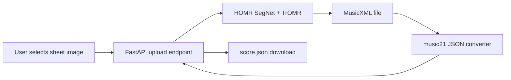

# Application Integration Guide

This guide explains how to add sheet-image upload and JSON download to a website using HOMR. The current repository pipeline has two stages:



HOMR itself writes MusicXML, not JSON. The repository's `coverted_to_json.py` converts MusicXML into the sample's flat `metadata` + `notes[]` format.

## 1. Install Runtime Dependencies

The JSON converter needs the `json` extra, which installs `music21`:

```powershell
poetry install --only main --extras cpu --extras json
poetry run homr --init
```

`homr --init` downloads the runtime model and OCR weights. Prepare these weights during deployment/image build where possible, rather than making the first customer request wait for downloads.

## 2. Add a JSON Endpoint

Keep the existing `POST /api/convert` endpoint if clients still need MusicXML. Add a separate `POST /api/convert/json` route in `docker/web/app.py`. This example uses a temporary directory, generated filenames, an allowlist, upload-size and processing-time limits, and argument arrays for subprocess calls.

```python
import json
import subprocess
import sys
import tempfile
from pathlib import Path

from fastapi import File, HTTPException, UploadFile
from fastapi.responses import JSONResponse

REPO_ROOT = Path(__file__).resolve().parents[2]
JSON_CONVERTER = REPO_ROOT / "coverted_to_json.py"
ALLOWED_SUFFIXES = {".png", ".jpg", ".jpeg"}
MAX_UPLOAD_BYTES = 8 * 1024 * 1024
PROCESS_TIMEOUT_SECONDS = 180


def _convert_uploaded_file(file: UploadFile) -> JSONResponse:
    suffix = Path(file.filename or "").suffix.lower()
    if suffix not in ALLOWED_SUFFIXES:
        raise HTTPException(status_code=415, detail="Upload a PNG or JPEG sheet image.")

    body = file.file.read(MAX_UPLOAD_BYTES + 1)
    if len(body) > MAX_UPLOAD_BYTES:
        raise HTTPException(status_code=413, detail="File too large (max 8 MB).")
    if not body:
        raise HTTPException(status_code=400, detail="Uploaded file is empty.")

    with tempfile.TemporaryDirectory(prefix="homr-") as temporary_directory:
        temporary_path = Path(temporary_directory)
        input_path = temporary_path / f"input{suffix}"
        musicxml_path = input_path.with_suffix(".musicxml")
        json_path = temporary_path / "score.json"
        input_path.write_bytes(body)

        try:
            omr_result = subprocess.run(
                [sys.executable, "-m", "homr.main", str(input_path)],
                cwd=REPO_ROOT,
                capture_output=True,
                text=True,
                timeout=PROCESS_TIMEOUT_SECONDS,
                check=False,
            )
        except subprocess.TimeoutExpired as error:
            raise HTTPException(status_code=504, detail="OMR processing timed out.") from error

        if omr_result.returncode != 0 or not musicxml_path.is_file():
            raise HTTPException(status_code=422, detail="Could not recognize this sheet image.")

        try:
            json_result = subprocess.run(
                [sys.executable, str(JSON_CONVERTER), str(musicxml_path), str(json_path)],
                cwd=REPO_ROOT,
                capture_output=True,
                text=True,
                timeout=60,
                check=False,
            )
        except subprocess.TimeoutExpired as error:
            raise HTTPException(status_code=504, detail="JSON conversion timed out.") from error

        if json_result.returncode != 0 or not json_path.is_file():
            raise HTTPException(status_code=500, detail="Could not create JSON output.")

        try:
            payload = json.loads(json_path.read_text(encoding="utf-8"))
        except json.JSONDecodeError as error:
            raise HTTPException(status_code=500, detail="Converter returned invalid JSON.") from error

        # Build the response before TemporaryDirectory removes the intermediate files.
        return JSONResponse(
            content=payload,
            headers={"Content-Disposition": 'attachment; filename="score.json"'},
        )


@app.post("/api/convert/json")
def convert_to_json(file: UploadFile = File(...)) -> JSONResponse:
    if not _jobs.acquire(blocking=False):
        raise HTTPException(status_code=429, detail="Server busy. Try again shortly.")
    try:
        return _convert_uploaded_file(file)
    finally:
        _jobs.release()
```

This is an integration example, not a drop-in patch. Merge the imports/constants with those already defined in `docker/web/app.py`. The wrapper reuses its `_jobs` semaphore so multiple requests cannot overload the model. Avoid returning a `FileResponse` pointing inside `TemporaryDirectory`: that directory is removed before the response may read the file. Returning a parsed `JSONResponse`, as above, avoids that lifetime bug.

## 3. Connect the Browser Upload

Send the selected file as `multipart/form-data`. Do not manually set the `Content-Type` header; the browser adds the multipart boundary.

```javascript
async function convertSheet(file) {
  const form = new FormData();
  form.append("file", file);

  const response = await fetch("/api/convert/json", {
    method: "POST",
    body: form,
  });

  if (!response.ok) {
    const error = await response.json().catch(() => ({}));
    throw new Error(error.detail ?? "Sheet conversion failed.");
  }

  const blob = await response.blob();
  const url = URL.createObjectURL(blob);
  const link = document.createElement("a");
  link.href = url;
  link.download = "score.json";
  link.click();
  URL.revokeObjectURL(url);
}
```

A minimal UI needs an image file input, a submit/processing state, a visible error state, and a download action when conversion succeeds. If the website and API have different origins, configure a strict CORS allowlist on the backend.

## 4. Build and Deploy

The existing Docker web app already serves a page and exposes `/api/convert`, but that endpoint returns MusicXML. To deploy JSON support:

1. Add the new route and frontend changes to your checked-out source.
2. Install `cpu` and `json` extras in the runtime image.
3. Ensure the image includes `coverted_to_json.py` and installs the project source. The current sample Dockerfile clones upstream HOMR during its build, so it will not include local changes unless you change the build to copy your checkout.
4. Pre-download model weights in the image build or mount a persistent model cache.
5. Put the service behind HTTPS, set request-size/rate limits at the proxy, keep debug logs private, and retain per-request temporary-file isolation.

The current container example listens on port 8000 internally and maps it to port 33203 on the host:

```powershell
docker build -f docker/Dockerfile -t homr .
docker run --rm -p 33203:8000 homr
```

The sample Dockerfile must also install the `json` extra and include your modified source before the JSON endpoint can work.

## 5. Test the Full Flow

Test each boundary before inviting users:

- Upload a known-good PNG/JPEG and verify the API returns valid JSON with `metadata` and `notes`.
- Verify unsupported extensions return `415`, empty/oversized files fail cleanly, and a processing timeout returns `504`.
- Verify HOMR failures do not return a stale `.musicxml` from another request; every request must use its own temporary directory.
- Test concurrent requests and apply a queue or worker model if inference blocks web workers or demand exceeds the configured concurrency.
- Keep MusicXML as an optional download while validating JSON quality.

## JSON Fidelity and Product Licensing

The current converter skips rests, flattens parts, and omits measure/onset positions. If the product needs voices, rests, chords as grouped events, or exact timing, extend the converter to preserve MusicXML offsets and measure/part structure before relying on the JSON as a score representation. The JSON is a derived export, not a lossless replacement for MusicXML.

HOMR is licensed under AGPL-3.0. Review [LICENSE](LICENSE), [README product guidance](README.md#using-homr-in-a-product), and [third-party notices](THIRD_PARTY_NOTICES.md) before using the project in a product, especially a closed-source or network-hosted product. This guide is technical documentation, not legal advice.
